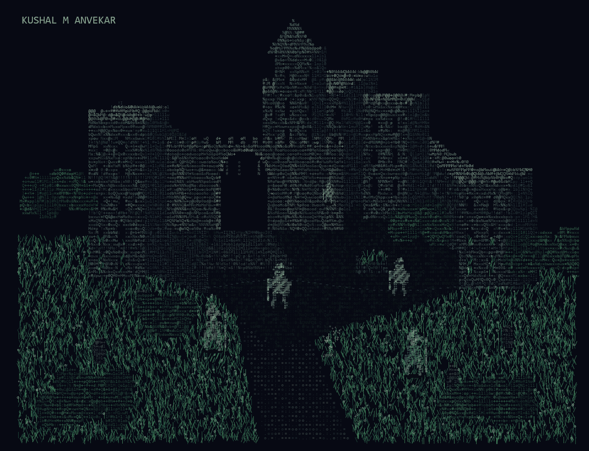

<!-- Animated ASCII castle artwork is hosted in ./assets. -->

<div align="center">
  
</div>

<br>

## The wanderer

> Building useful software at the intersection of AI, security, developer tools, and independent research. Computer Science diploma student at M. S. Ramaiah Polytechnic.

## The forge

| System | Artifact notes | Source |
|:---|:---|:---|
| `01 / sentinel` | Multi-language static analysis with deterministic rules, AST-aware matching, and optional LLM triage | [Explore ↗](https://github.com/Kushalongit-hub/Sentinel) |
| `02 / bedrock` | Portable, model-agnostic AI runtime with tools, memory, policy, workflows, and evaluation | [Explore ↗](https://github.com/Kushalongit-hub/Bedrock) |
| `03 / vakil-ai` | RAG-powered legal research and document drafting for Indian lawyers | [Explore ↗](https://github.com/Kushalongit-hub/Vakil-ai) |
| `04 / mesh` | AI agent collaboration, payments, and verifiable reputation on Monad | [Explore ↗](https://github.com/Kushalongit-hub/Mesh) |
| `05 / openconnect` | A portable development environment that lives in your pocket | [Explore ↗](https://github.com/Kushalongit-hub/OpenConnect) |
| `06 / mute` | Training-free background preservation for mask-free image editing | [Explore ↗](https://github.com/Kushalongit-hub/MUTE-Mask-free-Unified-Token-Editing) |
| `07 / 3d spatial grounding` | Research prototype for single-image 3D layouts using metric depth, supplied camera intrinsics, and optional VLM support judgments | [Explore ↗](https://github.com/Kushalongit-hub/VLM-Guided-3D-Spatial-Grounding-and-Scene-Dissection) |
| `08 / rcm` | Local 3D racing for 1–4 players with phones as gyro steering wheels, split-screen, and offline play | [Explore ↗](https://github.com/Kushalongit-hub/RCM) |
| `09 / try-on` | AI-powered virtual try-on for fashion and beauty, with photo uploads, camera capture, and multi-product layering | [Explore ↗](https://github.com/Kushalongit-hub/Try-On) |

[Browse all public repositories ↗](https://github.com/Kushalongit-hub?tab=repositories)

## The study

```text
$ cat research.notes
  spatial intelligence    -> understanding the physical structure of scenes
  image editing / MUTE    -> exploring localized edits and preservation
  agent infrastructure   -> memory, execution policy and tool boundaries
```

## The arsenal

```text
~/toolkit
├── language       Python / Java / JavaScript / SQL
├── intelligence   PyTorch / NLP / RAG / LLMs
├── backend        FastAPI / Node.js
└── infrastructure Docker / Linux / WSL / Git / MCP
```

## Summon signs

<div align="center">

[**PORTFOLIO**](https://kushalmanvekar.runs-on.dev/) &nbsp; · &nbsp; [**GITHUB**](https://github.com/Kushalongit-hub) &nbsp; · &nbsp; [**LINKEDIN**](https://www.linkedin.com/in/kushal-m-anvekar/)

</div>

<br>

> `building systems / breaking assumptions / learning in public`

<div align="center"><sub><code>keep the flame alive.</code></sub></div>
